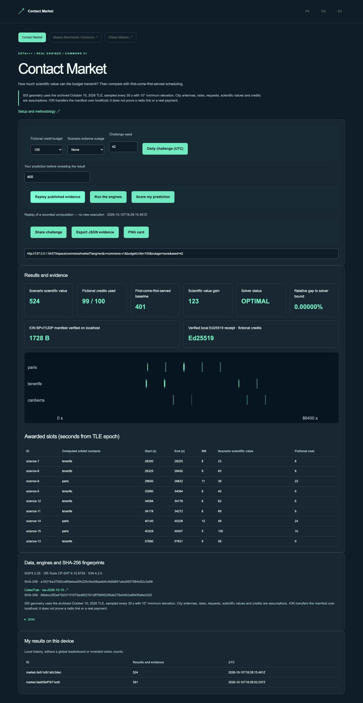

# Contact Market

## Public demo without installation

[Open the EN demo](https://gbesse.github.io/contact-market/en/space/commons/market/?lang=en) · [FR](https://gbesse.github.io/contact-market/fr/space/commons/market/?lang=fr) · [ES](https://gbesse.github.io/contact-market/es/space/commons/market/?lang=es).

The public edition replays archived computational evidence and retains daily challenges, shareable settings and JSON/PNG exports. It runs no engine and exposes no local API. The daily challenge comes from a fixed catalog; no global leaderboard or external audience is assumed. GitHub Pages is rebuilt and tested on every change to `main`.

To host under a path, use `SITE_BASE_PATH=/contact-market/ npm run build`. Without this variable the site still works at a domain root. All three languages, links, resources and evidence stay under that prefix. `manifest.json` records `basePath`.

[](https://github.com/gbesse/contact-market/actions) · [](LICENSE) · FR / EN / ES

[Français](README.md) · English · [Español](README.es.md)

Optimize transmitted science under a budget.

Compute ISS contacts from an archived TLE, optimize requests with OR-Tools CP-SAT, compare against first-come-first-served and verify an ION BPv7/UDP manifest on localhost.



## Try in one minute

The demo uses actual computations archived and supplied in this standalone repository. Node.js 22+ is sufficient; no account, API key, parent repository or external service is needed for replay.

```sh
git clone https://github.com/gbesse/contact-market.git
cd contact-market
node bin/cli.js demo --locale=en
npm start
```

http://127.0.0.1:4324/?lang=en

Local FR/EN/ES UI, daily UTC challenge in a fixed catalog, scored prediction, reproducible parameter URL, JSON evidence and PNG card. History is local; no global leaderboard or invented traffic.

## Run the real engines

Python 3.11–3.13, curl, C compiler, make, autoconf and libtool. ION is compiled locally without changing system settings.

SGP4 2.25 · OR-Tools 9.15.6755 · ION 4.2.0 · Ed25519

```sh
npm run setup:engines
npm run test:engines
node bin/cli.js run --locale=en
```

The “Run” button and `run` command start installed engines; “Replay” does not rerun an engine. No synthetic fallback. Setup downloads only this project’s dependencies into Git-ignored `.local/space-runtime`. `SPACE_RUNTIME` may point to an existing runtime; `SPACE_LOCALE` sets setup language.

## Method, data and limitations

ISS geometry uses the archived October 10, 2026 TLE, sampled every 30 s with 10° minimum elevation. City antennas, rates, requests, scientific values and credits are assumptions. ION transfers the manifest over localhost; it does not prove a radio link or a real payment.

Versions, parameters, hashes and notices are included. Large H5/SPK files and binaries are not redistributed; their sources and SHA-256 are pinned. External dependencies and data retain their respective terms.

Independent MIT software project, without affiliation with NASA/JPL, ESA or cited providers. No fabrication machine software or API is required. Code extracted from Frontier Lab and adapted to a standalone repository; provenance in `upstream.json`. User data is not translated. CLI exports never overwrite files.

## Verify and contribute

```sh
npm ci
npm test
npx playwright install chromium
npm run test:browser
npm run format:check
```

`npm run build` exports `output/site` for static hosting at a domain root. This edition replays published cases, without exposing engines or local APIs.

[Mission Benchmark Commons](https://github.com/gbesse/mission-benchmark-commons) · [Contact Market](https://github.com/gbesse/contact-market) · [Citizen Mission](https://github.com/gbesse/citizen-mission)

## Independent schedule audit

`verifyMarketSchedule(result, config)` recomputes time constraints, duplicates, unavailable stations, volumes, costs and science totals from declared requests/contacts. Replays and new computations include `scheduleAudit` and reject inconsistencies. This checks declared feasibility/accounting, not CP-SAT optimality, source authenticity or a real radio link. Receipts and ION proofs remain separately verified.
