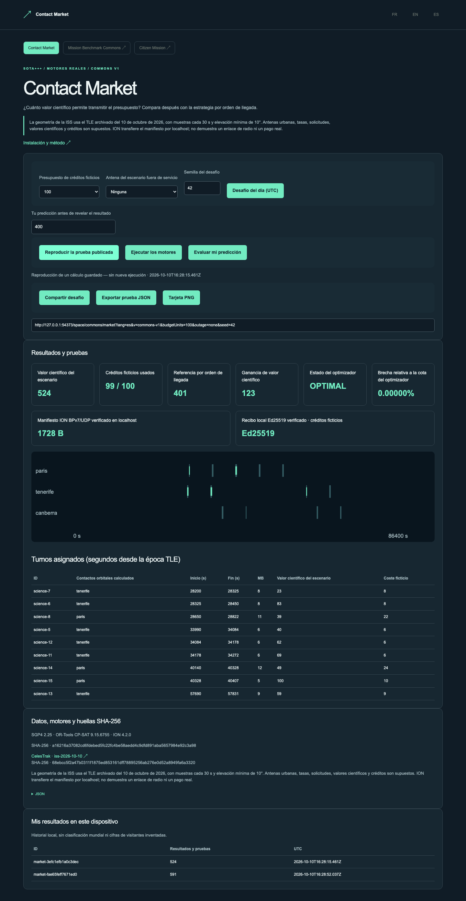

# Contact Market

[](https://github.com/gbesse/contact-market/actions) · [](LICENSE) · FR / EN / ES

[Français](README.md) · [English](README.en.md) · Español

Optimizar la ciencia transmitida con presupuesto.

Calcular contactos ISS desde un TLE archivado, optimizar solicitudes con OR-Tools CP-SAT, comparar con orden de llegada y verificar un manifiesto ION BPv7/UDP en localhost.



## Probar en un minuto

La demo usa cálculos reales archivados e incluidos en este repositorio autónomo. Node.js 22+ basta; no se necesita cuenta, clave API, repositorio padre ni servicio externo para reproducir.

```sh
git clone https://github.com/gbesse/contact-market.git
cd contact-market
node bin/cli.js demo --locale=es
npm start
```

http://127.0.0.1:4324/?lang=es

Interfaz local FR/EN/ES, desafío diario UTC de un catálogo fijo, predicción evaluada, URL reproducible de parámetros, prueba JSON y tarjeta PNG. Historial local; sin clasificación global ni tráfico inventado.

## Ejecutar motores reales

Python 3.11–3.13, curl, compilador C, make, autoconf y libtool. ION se compila localmente sin cambiar parámetros del sistema.

SGP4 2.25 · OR-Tools 9.15.6755 · ION 4.2.0 · Ed25519

```sh
npm run setup:engines
npm run test:engines
node bin/cli.js run --locale=es
```

El botón «Ejecutar» y el comando `run` inician motores instalados; «Reproducir» no inicia ningún motor. Sin sustitución sintética. La instalación descarga solo dependencias del proyecto en `.local/space-runtime`, ignorado por Git. `SPACE_RUNTIME` puede indicar un runtime existente; `SPACE_LOCALE` selecciona idioma de instalación.

## Método, datos y límites

La geometría de la ISS usa el TLE archivado del 10 de octubre de 2026, con muestras cada 30 s y elevación mínima de 10°. Antenas urbanas, tasas, solicitudes, valores científicos y créditos son supuestos. ION transfiere el manifiesto por localhost; no demuestra un enlace de radio ni un pago real.

Se incluyen versiones, parámetros, huellas y avisos. No se redistribuyen archivos H5/SPK ni binarios; sus fuentes y SHA-256 están fijados. Dependencias y datos externos mantienen sus condiciones.

Proyecto de software independiente MIT, sin afiliación con NASA/JPL, ESA ni proveedores citados. No necesita software ni API de máquinas de fabricación. Código extraído de Frontier Lab y adaptado a repositorio autónomo; procedencia en `upstream.json`. No se traducen datos del usuario. Las exportaciones CLI no sobrescriben archivos.

## Verificar y contribuir

```sh
npm ci
npm test
npx playwright install chromium
npm run test:browser
npm run format:check
```

`npm run build` exporta `output/site` para alojamiento estático en la raíz de un dominio. Esta edición reproduce casos publicados, sin exponer motores ni API locales.

[Mission Benchmark Commons](https://github.com/gbesse/mission-benchmark-commons) · [Contact Market](https://github.com/gbesse/contact-market) · [Citizen Mission](https://github.com/gbesse/citizen-mission)
