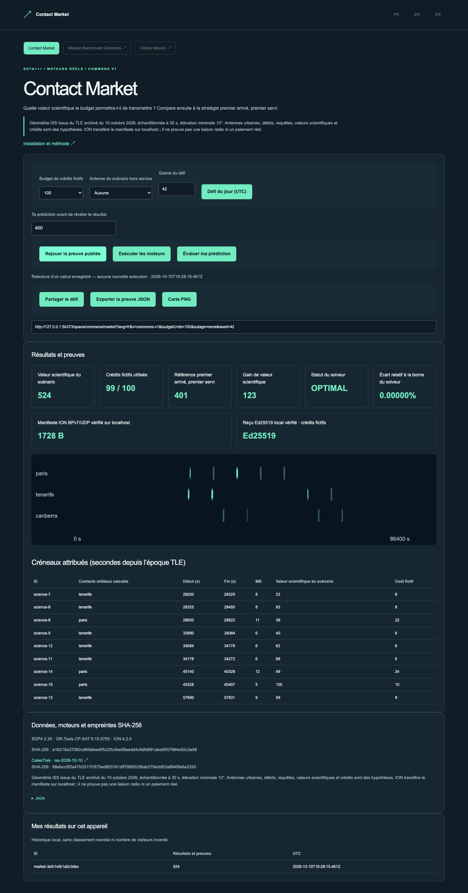

# Contact Market

## Démo publique sans installation

[Ouvrir la démo FR](https://gbesse.github.io/contact-market/fr/space/commons/market/?lang=fr) · [EN](https://gbesse.github.io/contact-market/en/space/commons/market/?lang=en) · [ES](https://gbesse.github.io/contact-market/es/space/commons/market/?lang=es).

L’édition publique rejoue les preuves de calcul archivées ; elle conserve le défi quotidien, les réglages partageables et les exports JSON/PNG. Elle n’exécute aucun moteur et n’expose aucune API locale. Le défi reste choisi dans un catalogue figé ; aucun classement mondial ni audience externe n’est présumé. La publication GitHub Pages est reconstruite et testée sur chaque changement de `main`.

Pour héberger sous un chemin, utiliser `SITE_BASE_PATH=/contact-market/ npm run build`. Sans cette variable, le site reste utilisable à la racine. Les trois langues, liens, ressources et preuves restent dans le même préfixe. `manifest.json` enregistre `basePath`.

[](https://github.com/gbesse/contact-market/actions) · [](LICENSE) · FR / EN / ES

Français · [English](README.en.md) · [Español](README.es.md)

Optimiser la science transmise sous budget.

Calculer les contacts ISS depuis un TLE archivé, optimiser les demandes avec OR-Tools CP-SAT, comparer à premier arrivé/premier servi et vérifier un manifeste ION BPv7/UDP sur localhost.



## Essayer en une minute

La démo utilise des calculs réellement exécutés et archivés, fournis dans ce dépôt autonome. Node.js 22+ suffit ; aucun compte, clé API, dépôt parent ou service externe n’est nécessaire pour la relecture.

```sh
git clone https://github.com/gbesse/contact-market.git
cd contact-market
node bin/cli.js demo --locale=fr
npm start
```

http://127.0.0.1:4324/?lang=fr

Interface locale FR/EN/ES, défi quotidien UTC dans un catalogue figé, prédiction scorée, URL de paramètres reproductible, preuve JSON et carte PNG. L’historique est local ; aucun classement mondial ni trafic inventé.

## Exécuter les vrais moteurs

Python 3.11–3.13, curl, compilateur C, make, autoconf et libtool. ION est compilé localement sans modification des paramètres système.

SGP4 2.25 · OR-Tools 9.15.6755 · ION 4.2.0 · Ed25519

```sh
npm run setup:engines
npm run test:engines
node bin/cli.js run --locale=fr
```

Le bouton « Exécuter » et la commande `run` lancent les moteurs installés ; « Rejouer » ne relance aucun moteur. Aucun résultat de secours synthétique. L’installation télécharge seulement les dépendances de ce projet, dans `.local/space-runtime`, ignoré par Git. `SPACE_RUNTIME` peut désigner un runtime déjà installé ; `SPACE_LOCALE` choisit la langue du script.

## Méthode, données et limites

Géométrie ISS issue du TLE archivé du 10 octobre 2026, échantillonnée à 30 s, élévation minimale 10°. Antennes urbaines, débits, requêtes, valeurs scientifiques et crédits sont des hypothèses. ION transfère le manifeste sur localhost ; il ne prouve pas une liaison radio ni un paiement réel.

Les versions, paramètres, empreintes et notices sont inclus. Les grands fichiers H5/SPK et les binaires ne sont pas redistribués ; leurs sources et SHA-256 sont épinglés. Les dépendances et données externes conservent leurs conditions respectives.

Projet logiciel indépendant sous licence MIT, sans affiliation NASA/JPL, ESA ou fournisseurs cités. Aucun logiciel ni API de machine de fabrication requis. Code extrait de Frontier Lab, adapté à un dépôt autonome ; provenance dans `upstream.json`. Les données utilisateur ne sont pas traduites. Les exports CLI n’écrasent pas les fichiers.

## Vérifier et contribuer

```sh
npm ci
npm test
npx playwright install chromium
npm run test:browser
npm run format:check
```

`npm run build` exporte `output/site` pour un hébergement statique à la racine d’un domaine. Cette édition rejoue les cas publiés, sans moteur ni API locale exposée.

[Mission Benchmark Commons](https://github.com/gbesse/mission-benchmark-commons) · [Contact Market](https://github.com/gbesse/contact-market) · [Citizen Mission](https://github.com/gbesse/citizen-mission)

## Audit indépendant du planning

`verifyMarketSchedule(result, config)` recalcule les contraintes temporelles, doublons, stations indisponibles, volumes, coûts et totaux scientifiques depuis les requêtes et contacts déclarés. Les replays et nouveaux calculs incluent `scheduleAudit` et refusent une incohérence. Cet audit vérifie la faisabilité et la comptabilité déclarées, pas l’optimalité CP-SAT, l’authenticité des sources ni une liaison radio réelle. Les reçus et preuves ION restent vérifiés séparément.

L’audit expose `requestCoverage` : demandes déclarées, identifiants reconnus, affectations et liste triée des demandes sans créneau. Une affectation n’est pas une livraison de données réelle ; la couverture n’est interprétable que si `valid` est vrai. Un total scientifique non fini est refusé et retourné comme `null`, même si deux valeurs infinies semblaient égales. Ces contrôles ne prouvent ni l’optimalité du solveur ni un service satellite réel.
